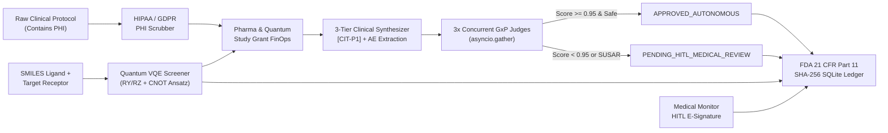

# 🧬⚛️ Quantum BioMed Research & GxP Governance Engine

> **Production-Grade Enterprise Reference Platform for Pharmaceutical R&D, GxP Clinical Trial Protocol Synthesis, Pharmacovigilance Multi-Judge Consensus, Hybrid Quantum-AI Molecular Screening (VQE), Clinical Study Token FinOps, and FDA 21 CFR Part 11 Cryptographic Auditability.**

[](https://python.org)
[](https://fastapi.tiangolo.com)
[]()
[]()
[]()
[](helm/biomed-gxp-engine)
[](LICENSE)
[-0A66C2?style=flat-square&logo=linkedin)](https://www.linkedin.com/in/marian-rop)
[](https://www.credly.com/users/marian-ropota/badges/credly)

---

## 🎯 Executive Value Proposition — For Big Pharma VPs of R&D, Principal Architects & Technical Recruiters

Modern Pharmaceutical R&D and Clinical Trial Operations (**ICH E6(R3) GxP**) face three structural bottlenecks when adopting Generative AI and Quantum Computing:
1. **Unacceptable Regulatory & Patient Safety Risk:** Standard LLMs hallucinate clinical endpoints, omit serious adverse events (**SUSARs**), or leak Protected Health Information (**HIPAA / GDPR PHI**) to external cloud APIs.
2. **Lack of FDA 21 CFR Part 11 Auditability:** Clinical trial systems require tamper-evident electronic records (`§11.10`) and legally binding Human-in-the-Loop (**HITL**) electronic signatures (`§11.50 / §11.70`) from Medical Monitors.
3. **Uncontrolled R&D Compute & Token Spend:** Clinical study grants and in-silico quantum drug discovery campaigns lack per-study chargeback/showback guardrails.

**`quantum-biomed-research-engine`** solves all three in a **100% functional, containerized, full-stack platform (FastAPI Backend + React 18 R&D Workbench + SQLite FDA Part 11 Ledger + Kubernetes Helm Chart)**:

- **🛡️ Deterministic HIPAA / GDPR PHI De-Identification (`src/privacy/phi_scrubber.py`):** Redacts Patient Names, MRNs, SSNs/CNPs, Dates of Birth, Emails, and Phone Numbers *before* any LLM call, recording SHA-256 digests of raw vs. scrubbed payloads.
- **⚖️ 3x Concurrent GxP Multi-Judge Consensus (`src/evaluators/multi_judge_consensus.py`):** Runs `ClinicalGroundednessJudge`, `PharmacovigilanceSafetyJudge`, and `GxPComplianceJudge` concurrently via `asyncio.gather`. Applies a mathematical variance penalty and automatically routes any synthesis with `consensus_score < 0.95` or a high-severity safety signal (`SUSAR`, `Grade 4/5 toxicity`) to **`PENDING_HITL_MEDICAL_REVIEW`**.
- **⚛️ Hybrid Quantum-AI Molecular Screening (`src/agents/quantum_molecular_screener.py`):** Maps candidate ligand **SMILES** strings and disease receptors (`KRAS-G12C`, `EGFR-T790M`, `BACE1`) into a parameterized quantum ansatz (`RY/RZ` rotations + `CNOT` entanglement ladder) to estimate Variational Quantum Eigensolver (**VQE**) ground-state energies (`E₀` in `Ha`) and binding affinities (`ΔG` in `kcal/mol`).
- **🔗 FDA 21 CFR Part 11 Cryptographic Hash-Chain Ledger (`src/compliance/fda_part11_ledger.py`):** Chains every clinical synthesis, quantum screen, and Medical Reviewer HITL electronic signature using `SHA-256` (`previous_hash → current_hash`) with live mathematical tamper verification (`GET /v1/audit/verify-integrity`).
- **💸 Pharmaceutical & Quantum Grant FinOps (`src/finops/study_budget.py`):** Tracks token and quantum statevector spend strictly per `clinical_study_id` (e.g., `STUDY-ONCO-KRAS-2026`), enforces HTTP `402` hard grant caps, and benchmarks savings against ephemeral Spot GPU NIM infrastructure.
- **🖥️ Modern Biotech SaaS Workbench (`src/static/index.html`):** Features a Left Sidebar + Top Telemetry Bar layout, **Dark Mode / Light Mode Toggle (`☀️ / 🌙`)**, Non-Blocking Background Execution with live stage timers (`⏱️ 0.1s...`), custom SVG Avatar (**Dr. Helix**), and a **Multi-Turn 3-Track Collapsible Copilot** (`+ Extend` preview cards + `🎯 Focus Track` deep-dive continuation).

---

## 📑 Table of Contents (Index)

- [🎯 Executive Value Proposition](#-executive-value-proposition--for-big-pharma-vps-of-rd-principal-architects--technical-recruiters)
- [🏛️ End-to-End Architecture & Dual-Mode Execution (Standalone + Connected Lab)](#️-end-to-end-architecture--dual-mode-execution-standalone--connected-lab)
- [📋 Regulatory & Compliance Mapping (GxP, FDA 21 CFR Part 11, HIPAA, EU AI Act)](#-regulatory--compliance-mapping-gxp-fda-21-cfr-part-11-hipaa-eu-ai-act)
- [🔌 REST API & React 18 Workbench Endpoints](#-rest-api--react-18-workbench-endpoints)
- [🚀 Quick Start (Local Python, Docker Compose & Kubernetes Helm)](#-quick-start-local-python-docker-compose--kubernetes-helm)
  - [1. Local Python & Automated End-to-End Test Suite (`pytest`)](#1-local-python--automated-end-to-end-test-suite-pytest)
  - [2. Docker Compose (With Persistent `/data` SQLite FDA Part 11 Volume)](#2-docker-compose-with-persistent-data-sqlite-fda-part-11-volume)
  - [3. Kubernetes / K3s Deployment via Helm Chart](#3-kubernetes--k3s-deployment-via-helm-chart)
- [💻 Live CLI & `curl` API Examples](#-live-cli--curl-api-examples)
- [🧪 Interactive Jupyter Notebooks (`examples/`)](#-interactive-jupyter-notebooks-examples)
- [📸 Live Workbench & API Screenshot Gallery](#-live-workbench--api-screenshot-gallery)
- [📚 Ecosystem & Portfolio Documentation](#-ecosystem--portfolio-documentation)
- [👨‍💻 Maintainer & Author](#-maintainer--author)

---

## 🏛️ End-to-End Architecture & Dual-Mode Execution (Standalone + Connected Lab)

Every module in this repository is built with **12-Factor Environment Configuration (`.env`)** and **Dual-Mode Execution**:
- **Mode A — 100% Standalone Out-of-the-Box (`LLM_LIVE_MODE=false` default):** Works immediately after `git clone` with zero API keys or external services. Uses the deterministic GxP clinical synthesizer, 3x concurrent calibration judges, and the built-in pure-Python complex statevector quantum VQE simulator.
- **Mode B — Connected Enterprise Lab (`LLM_LIVE_MODE=true`):** Routes live inference across the [**AI-Governance-Lab**](docs/portfolio-mapping.md) ecosystem:
  - **Tier 1 (`NIM_DIRECT_BASE_URL`):** Direct self-hosted NVIDIA NIM / TensorRT-LLM GPU containers (from `nvidia-nim-enterprise-patterns`).
  - **Tier 2 (`LITELLM_BASE_URL`):** Centralized LiteLLM Gateway (`:4001` from `private-enterprise-ai-hub`) with automatic multi-model failover (`gemini-3.8-flash → glm-5.2 → gemini-3.1-pro-preview → nvidia/nemotron-3-ultra-550b-a55b → codestral-2508`).
  - **Tier 3 (Automatic Failover):** Falls back transparently to the deterministic local GxP engine if external gateways are unreachable.



---

## 📋 Regulatory & Compliance Mapping (GxP, FDA 21 CFR Part 11, HIPAA, EU AI Act)

| Regulatory Framework | Requirement | Concrete Implementation in `quantum-biomed-research-engine` |
|---|---|---|
| **FDA 21 CFR Part 11 (§11.10)** | Tamper-evident, time-stamped computer-generated audit trails. | `src/compliance/fda_part11_ledger.py`: Cryptographic SHA-256 hash chaining (`current_hash = sha256(previous_hash + timestamp_utc + study_id + scrubbed_hash + output + score + signature)`), verified via `GET /v1/audit/verify-integrity`. |
| **FDA 21 CFR Part 11 (§11.50 / §11.70)** | Signature manifestations (printed reviewer ID, UTC date/time, meaning) cryptographically linked to their respective electronic records. | `POST /v1/hitl/sign-record`: Appends an immutable `HITL_ELECTRONIC_SIGNATURE` block linking `medical_reviewer_id`, `electronic_signature_meaning`, and the target record's SHA-256 digest. |
| **HIPAA Safe Harbor & GDPR Art. 9** | De-identification of Protected Health Information (PHI) and special-category health data before external processing. | `src/privacy/phi_scrubber.py`: Deterministic regex + rule-based redaction of Patient Names, MRNs, SSNs/CNPs, DOBs, Emails, and Phones prior to any LLM call. |
| **EU AI Act (High-Risk Medical / Annex III)** | Human oversight (Art. 14), accuracy/robustness (Art. 15), and automatic logging (Art. 12). | `src/evaluators/multi_judge_consensus.py`: 3 independent calibration judges with variance penalty and mandatory escalation to `PENDING_HITL_MEDICAL_REVIEW`. |

> **Architectural Scope Note:** This repository is an open-source **enterprise reference architecture** demonstrating GxP, HIPAA, and FDA 21 CFR Part 11 software engineering patterns in code. In a commercial pharmaceutical deployment, production qualification additionally requires formal Computer System Validation (CSV — IQ/OQ/PQ) per GAMP 5.


---

## 🔌 REST API & React 18 Workbench Endpoints

| Method | Endpoint | Description |
|---|---|---|
| `GET` | `/` | **Interactive React 18 BioMed & Quantum R&D Workbench** (4 tabs: Clinical Synthesis, Quantum VQE Screener, FDA Part 11 Ledger & HITL E-Signature, Pharma/Quantum FinOps). |
| `GET` | `/docs` | Interactive OpenAPI 3.1 / Swagger UI documentation. |
| `GET` | `/healthz` & `/readyz` | Kubernetes liveness and readiness probes (verifies SQLite persistence & SHA-256 ledger integrity). |
| `POST` | `/v1/clinical/synthesize` | Runs HIPAA PHI Scrubber → FinOps Grant Check → Clinical Synthesizer (`[CIT-Px]`) → 3x Concurrent GxP Judges → FDA Part 11 Ledger. |
| `POST` | `/v1/quantum/screen-molecule` | Runs Hybrid Quantum VQE simulation (`RY/RZ` + `CNOT`) for SMILES drug candidates, charges R&D study budget, and appends to FDA Part 11 Ledger. |
| `POST` | `/v1/hitl/sign-record` | Appends a Medical Reviewer Human-in-the-Loop (HITL) Electronic Signature (`21 CFR §11.50`) linked to a clinical record. |
| `GET` | `/v1/audit/ledger` | Returns historical SHA-256 hash-chained records from the SQLite ledger. |
| `GET` | `/v1/audit/verify-integrity` | Recomputes the entire SHA-256 chain from genesis to mathematically prove zero tampering. |
| `GET` | `/v1/finops/studies/{study_id}` | Returns Clinical Study & Quantum R&D token/compute spend, remaining grant cap, and Spot GPU NIM showback comparison. |

---

## 🚀 Quick Start (Local Python, Docker Compose & Kubernetes Helm)

### 1. Local Python & Automated End-to-End Test Suite (`pytest`)
Works 100% out-of-the-box with zero external API keys required:
```bash
cd quantum-biomed-research-engine
cp .env.example .env

# Run the end-to-end test suite (PHI redaction, 3x GxP judges, Quantum VQE, HITL e-signature, FinOps 402 cap, SHA-256 tamper detection)
pytest -v

# Start the FastAPI backend + React 18 Workbench on http://localhost:8000
uvicorn src.main:app --host 0.0.0.0 --port 8000
```

### 2. Docker Compose (With Persistent `/data` SQLite FDA Part 11 Volume)
```bash
cp .env.example .env
docker compose up --build -d
# Open http://localhost:8000 for the React 18 Workbench or http://localhost:8000/docs for Swagger UI
```

### 3. Kubernetes / K3s Deployment via Helm Chart
Includes non-root `securityContext` (`uid=10001`), `/healthz` and `/readyz` probes, `ConfigMap`, and `PersistentVolumeClaim` mounted at `/data`:
```bash
helm upgrade --install biomed-gxp-engine ./helm/biomed-gxp-engine \
  --namespace biomed-gxp --create-namespace \
  --set service.nodePort=30089
```
To connect to the centralized **LiteLLM Gateway (`private-enterprise-ai-hub`)** on your LAN cluster:
```bash
helm upgrade --install biomed-gxp-engine ./helm/biomed-gxp-engine \
  --namespace biomed-gxp --create-namespace \
  --set config.LLM_LIVE_MODE="true" \
  --set config.LITELLM_BASE_URL="http://<LITELLM_GATEWAY_IP>:4001/v1"
```

---

## 💻 Live CLI & `curl` API Examples

Once the server is running (`http://localhost:8000` locally or `http://<K3S_NODE_IP>:30089` on Kubernetes), you can test every regulatory, clinical, quantum, and FinOps workflow directly from your terminal:

### 1. Kubernetes Health & Readiness Probes (`/healthz` & `/readyz`)
```bash
curl -s http://localhost:8000/healthz | jq .
curl -s http://localhost:8000/readyz | jq .
```

### 2. Clinical Trial Protocol Synthesis + HIPAA PHI Scrubber + 3x GxP Multi-Judge Consensus
Redacts Patient Name, DOB, MRN, SSN, and Email prior to inference, synthesizes the protocol with mandatory `[CIT-P1]` / `[CIT-P2]` anchors, runs 3 concurrent GxP judges via `asyncio.gather`, and chains the record into the FDA 21 CFR Part 11 SQLite ledger:
```bash
curl -s -X POST http://localhost:8000/v1/clinical/synthesize \
  -H "Content-Type: application/json" \
  -d '{
    "clinical_study_id": "STUDY-ONCO-KRAS-2026",
    "target_biomarker": "KRAS-G12C",
    "protocol_text": "Patient Name: Johnathan Miller, DOB: 1968-04-19, MRN: ONC-884920, SSN: 412-88-9021, Email: j.miller68@clinical.org. Cohort A evaluated oral covalent KRAS-G12C inhibition (960 mg QD). Safety logs recorded Grade 2 nausea, mild diarrhea, fatigue, and transient elevated ALT/AST hepatic transaminases. Subjects with Child-Pugh B/C hepatic impairment were excluded.",
    "preferred_model": "gemini-3.8-flash"
  }' | jq .
```

### 3. Hybrid Quantum VQE Molecular Screening (`SMILES → E₀ (Hartrees) & ΔG (kcal/mol)`)
Screens **Sotorasib** (`AMG-510` scaffold) against the **`KRAS-G12C`** receptor across 6 active-space qubits and 3 variational `RY/RZ + CNOT` layers:
```bash
curl -s -X POST http://localhost:8000/v1/quantum/screen-molecule \
  -H "Content-Type: application/json" \
  -d '{
    "clinical_study_id": "STUDY-ONCO-KRAS-2026",
    "molecule_smiles": "C=CC(=O)N1CCN(CC1)C2=NC(=O)N(C=C2C3=C(C=CC=C3F)O)C4=C(C=CN=C4C(C)C)C",
    "target_receptor": "KRAS-G12C",
    "num_qubits": 6,
    "ansatz_layers": 3
  }' | jq .
```

### 4. FDA 21 CFR Part 11 HITL Electronic Signature & SHA-256 Chain Verification
Append a legally binding Medical Monitor Electronic Signature (`21 CFR §11.50 / §11.70`) and mathematically verify zero database tampering across the entire hash chain:
```bash
# 4a. Append HITL Electronic Signature (replace FDA11-XXXXXXXXXXXX with a record_id from step 2)
curl -s -X POST http://localhost:8000/v1/hitl/sign-record \
  -H "Content-Type: application/json" \
  -d '{
    "record_id": "FDA11-XXXXXXXXXXXX",
    "medical_reviewer_id": "MD-ROCHE-4491",
    "electronic_signature_meaning": "Medical Monitor Safety Review & Release Approval (21 CFR 11.50)",
    "approved": true,
    "reviewer_notes": "Confirmed hepatic transaminase monitoring protocol and DSMB clearance."
  }' | jq .

# 4b. Verify Cryptographic SHA-256 Hash-Chain Integrity from Genesis to Latest Block
curl -s http://localhost:8000/v1/audit/verify-integrity | jq .

# 4c. Inspect Overall & Grouped Judge Score Analytics (by Study, Evaluation Type & Biomarker)
curl -s http://localhost:8000/v1/audit/analytics | jq .
```

### 5. Pharmaceutical & Quantum R&D Clinical Study Grant FinOps
```bash
# Allocate or update a Clinical Study R&D Grant budget cap ($5,000 USD)
curl -s -X POST http://localhost:8000/v1/finops/allocate-grant \
  -H "Content-Type: application/json" \
  -d '{
    "clinical_study_id": "STUDY-ONCO-KRAS-2026",
    "allocated_budget_usd": 5000.00
  }' | jq .

# Inspect per-study token/quantum chargeback & Spot L4 GPU NIM savings
curl -s http://localhost:8000/v1/finops/studies/STUDY-ONCO-KRAS-2026 | jq .
```

### 6. Multi-Turn 3-Track Dr. Helix AI Copilot (`plain` | `scientist` | `steps` | `dual`)
```bash
curl -s -X POST http://localhost:8000/v1/assistant/chat \
  -H "Content-Type: application/json" \
  -d '{
    "question": "Explain the Quantum VQE Molecular Screener and how ΔG binding affinity is derived.",
    "persona_mode": "dual",
    "history": []
  }' | jq .
```

---

## 🧪 Interactive Jupyter Notebooks (`examples/`)

For computational chemists, clinical data scientists, and GxP auditors who prefer interactive notebook experimentation, the repository includes two ready-to-run Jupyter Notebooks in [`examples/`](examples/):

1. [**`examples/01_clinical_gxp_synthesis_and_fda_part11_audit.ipynb`**](examples/01_clinical_gxp_synthesis_and_fda_part11_audit.ipynb)
   - Demonstrates deterministic HIPAA/GDPR PHI redaction (`PHIScrubber`), clinical trial synthesis (`ClinicalTrialSynthesizer`), concurrent 3-judge consensus (`CalibratedMultiJudgeConsensus`), and FDA 21 CFR Part 11 SHA-256 hash-chain verification + HITL electronic signatures.
2. [**`examples/02_quantum_vqe_drug_screening_and_grant_finops.ipynb`**](examples/02_quantum_vqe_drug_screening_and_grant_finops.ipynb)
   - Demonstrates in-silico SMILES ligand screening (`Sotorasib` on `KRAS-G12C`) using the `2^N` statevector VQE simulator (`RY/RZ` + `CNOT` ansatz), inspecting ground-state energy `E₀` (Hartrees), binding affinity `ΔG` (`kcal/mol`), ASCII quantum circuits, and Clinical Study Grant FinOps accounting.

```bash
pip install jupyter
jupyter notebook examples/
```

---

## 📸 Live Workbench & API Screenshot Gallery

Below are live full-resolution captures from the **Quantum BioMed R&D & GxP Governance Workbench** deployed on Kubernetes (`K3s NodePort :30089`), showcasing the **Left Sidebar + Top Telemetry Bar App Shell**, **Clinical Protocol Synthesis & 3x GxP Multi-Judge Consensus**, **Hybrid Quantum VQE Molecular Screener**, **FDA 21 CFR Part 11 SHA-256 Ledger & Memory-Aware Judge Analytics**, **Clinical Study Grant FinOps**, and **Dr. Helix Multi-Turn 3-Track Copilot**:

<details open>
<summary><b>Click here to view the Live BioMed GxP, Quantum VQE, FDA Part 11 & Multi-Turn Copilot Screenshots (<code>prtscr&logs/pictures/</code>)</b></summary>
<br>

<div align="center">
  
  
  
  
</div>

</details>

- 📂 **Direct link to screenshot folder:** [`prtscr&logs/pictures/`](prtscr%26logs/pictures/)

---

## 📚 Ecosystem & Portfolio Documentation

- [**`docs/portfolio-mapping.md`**](docs/portfolio-mapping.md) — How `quantum-biomed-research-engine` integrates with `private-enterprise-ai-hub`, `governed-quantum-agents`, and `nvidia-nim-enterprise-patterns`, plus the **Pharma & Quantum Interview Competency Matrix**.

---

## 👨‍💻 Maintainer & Author

**Marian Ropota** — *Principal AI/ML & Quantum Platform Architect | Regulated Life Sciences AI, Hybrid Cloud Infrastructure & Agentic Engineering*  
🔗 **[LinkedIn](https://www.linkedin.com/in/marian-rop)** • 🏅 **[Credly Certifications](https://www.credly.com/users/marian-ropota/badges/credly)** • 🐙 **[AI Governance Lab](https://github.com/AI-Governance-Lab)**

*Part of the **AI Governance Lab** open-source engineering portfolio — bridging scientific R&D, quantum simulation, and regulated enterprise production.*
