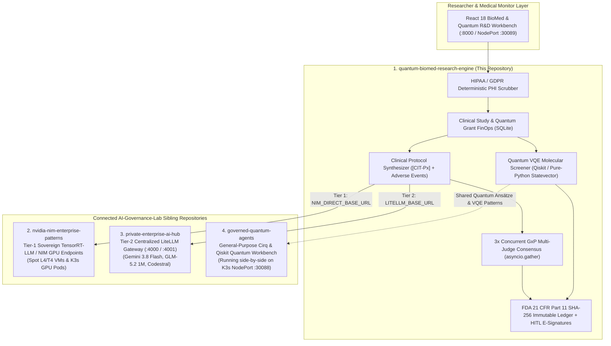

# 🧬⚛️ AI-Governance-Lab Ecosystem & Pharma R&D Portfolio Mapping

> **How `quantum-biomed-research-engine` operates 100% Standalone out-of-the-box while integrating natively with the broader `AI-Governance-Lab` enterprise architecture.**

---

## 1. Dual-Execution Philosophy: Standalone Portability + Multi-Cluster Lab Integration

A critical requirement for Pharmaceutical R&D and Regulated AI platforms is **reproducibility without external lock-in**:

1. **100% Standalone Mode (Default after `git clone`):**
   - When `LLM_LIVE_MODE="false"` (the default in `.env.example`), the engine requires **zero external API keys, zero cloud GPUs, and zero external containers**.
   - Clinical trial protocol synthesis uses the built-in **Deterministic GxP Clinical Synthesizer**, the **3x Concurrent GxP Multi-Judge Consensus Engine** (`asyncio.gather`), and the **Pure-Python Complex Statevector Quantum VQE Simulator** ($2^N$ Hilbert space with `RY`, `RZ`, and `CNOT` unitary operators).
   - Every test in `pytest -v` and every interactive workflow in the React 18 Workbench (`GET /`) works immediately on any laptop or CI runner.

2. **Connected Enterprise Lab Mode (`LLM_LIVE_MODE="true"`):**
   - When deployed inside the `AI-Governance-Lab` multi-server topology, `quantum-biomed-research-engine` connects via environment variables (`.env` / Kubernetes `ConfigMap`) to its three sibling repositories:

---

## 2. How the Four Repositories Complement Each Other

| Repository | Primary Domain Focus | Role in Pharmaceutical & Quantum R&D Architecture |
|---|---|---|
| **`quantum-biomed-research-engine`** *(This Repo)* | **Life Sciences GxP, Clinical Trials, Pharmacovigilance, Quantum Drug Screening & FDA 21 CFR Part 11** | Enforces HIPAA PHI redaction prior to inference, runs 3 concurrent GxP calibration judges, simulates ligand-receptor binding via VQE (`SMILES → ΔG kcal/mol`), tracks R&D grant budgets per `clinical_study_id`, and chains every record with SHA-256 + HITL electronic signatures. |
| **`private-enterprise-ai-hub`** | **Sovereign Multi-Model AI Gateways (`litellm :4000 & :4001`)** | Acts as the **Tier-2 AI Gateway** (`LITELLM_BASE_URL`) providing multi-model failover across Google Vertex AI (`gemini-3.8-flash`, `glm-5.2`), Mistral (`codestral-2508`), and NVIDIA NIM APIs. |
| **`governed-quantum-agents`** | **Multi-Domain Hybrid Quantum Discovery (`Cirq` & `Qiskit`)** | Provides the broad quantum algorithmic foundation (**VQE, QAOA, Grover, QSVM**) on K3s (`NodePort 30088`), while `quantum-biomed-research-engine` (`NodePort 30089`) specializes VQE specifically for **pharmaceutical SMILES lead optimization under FDA Part 11 compliance**. |
| **`nvidia-nim-enterprise-patterns`** | **Ephemeral Spot GPU & K3s NVIDIA NIM Infrastructure (Terraform)** | Provides the **Tier-1 Sovereign GPU Inference** pattern (`NIM_DIRECT_BASE_URL`) and the **60–70% Spot L4 GPU cost benchmarks** used by `study_budget.py` to calculate pharmaceutical R&D showback savings. |

---

## 3. Target Roles & Concrete Interview Proof Matrix

| Target Role in Pharma / Biotech / Quantum | What Hiring Committees Look For | Exact Code Proof in This Repository |
|---|---|---|
| **Principal AI / ML Architect — Life Sciences & Clinical Development** *(Roche, Novartis, AstraZeneca, Pfizer, Sanofi)* | End-to-end GxP compliance, HIPAA Safe Harbor de-identification, FDA 21 CFR Part 11 electronic records, and hallucination prevention in clinical protocols. | `src/privacy/phi_scrubber.py`, `src/evaluators/multi_judge_consensus.py`, and `src/compliance/fda_part11_ledger.py` (SHA-256 hash chain + HITL e-signature). |
| **Quantum Drug Discovery / Computational Chemistry Software Engineer** *(Schrödinger, SandboxAQ, Quantinuum, Big Pharma In-Silico Teams)* | Translating molecular structures (`SMILES`) and protein targets (`KRAS-G12C`, `EGFR`, `BACE1`) into parameterized quantum circuits (`RY/RZ` + `CNOT`) and VQE energy trajectories. | `src/agents/quantum_molecular_screener.py` (supports both `Qiskit` statevector execution and an exact pure-Python `2^N` complex statevector simulator). |
| **Clinical AI Governance & Pharmacovigilance Lead** *(IQVIA, Parexel, Labcorp, EMA/FDA Regulated CROs)* | Automated detection of omitted Adverse Events (AEs), SUSAR escalation to Medical Monitors, and mathematical consensus scoring. | `PharmacovigilanceSafetyJudge` in `src/evaluators/multi_judge_consensus.py` + automatic routing to `PENDING_HITL_MEDICAL_REVIEW` when `consensus_score < 0.95`. |
| **R&D Platform & Scientific FinOps Architect** | Controlling token and quantum simulation spend per clinical trial grant (`clinical_study_id`) with hard budget guardrails. | `src/finops/study_budget.py` (SQLite grant controller enforcing HTTP 402 budget caps and comparing Spot GPU NIM vs. proprietary API spend). |
